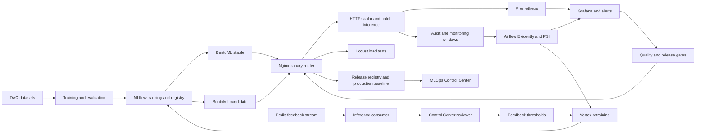

# MENA MLOps Project

Project workspace for the MLOps Practitioner course. It provides a
reproducible Arabic sentiment system with DVC data versioning, AraBERT
training, MLflow tracking, BentoML serving, Nginx canaries, Redis Streams,
Prometheus/Grafana monitoring, Evidently/PSI drift detection, human feedback,
and gated retraining.

## Repository layout

```text
mena-mlops-project/
├── configs/              # Versioned, non-secret configuration
├── data/
│   ├── raw/              # Source data (not committed)
│   └── processed/        # Generated data (not committed)
├── docs/                 # Architecture and project documentation
├── models/               # Generated model artifacts (not committed)
├── notebooks/            # Exploratory analysis
├── src/mena_mlops/       # Production Python package
├── tests/                # Automated tests
├── .github/workflows/    # Continuous integration
├── Makefile
└── pyproject.toml
```

The complete system architecture is documented in
[`docs/architecture.md`](docs/architecture.md).

Operational commands, environment setup, experiment workflows, and evidence
capture are documented in [`docs/operations-runbook.md`](docs/operations-runbook.md).
Cloud resources, the MLflow VM, Artifact Registry, and Vertex AI deployment are
documented in [`docs/cloud-deployment.md`](docs/cloud-deployment.md).
The course-rubric evidence map is in
[`docs/rubric-evidence.md`](docs/rubric-evidence.md).

## Reviewer quickstart (exactly three commands)

From a clean checkout with Docker and `uv` installed:

```bash
uv sync --locked
python scripts/download_model_bundle.py
docker compose up --build -d
```

The gateway is then available at `http://localhost:8080`. The model bundle
command retrieves the public evaluation artifacts only; private credentials
are still required for DVC, cloud MLflow artifacts, and Vertex workflows.

## Final architecture



This diagram covers the course flow from data/versioning and training through
registry, optimized serving, canary deployment, monitoring, feedback,
retraining, and release operations.

## Session changelog

- **Session 1 - reproducible data and training:** DVC data stages, typed
  training code, locked dependencies, and MLflow lineage.
- **Session 2 - optimization and serving:** ONNX FP32/INT8 variants, CPU-only
  BentoML serving, scalar inference, vectorized batch inference, and Locust
  measurements.
- **Session 3 - production operations:** Nginx stable/candidate routing,
  canary weights, rollback, audit provenance, Redis feedback, and reviewer
  workflows.
- **Session 4 - monitoring and retraining:** Prometheus/Grafana,
  Evidently/PSI, Airflow scheduling, feedback thresholds, retraining gates,
  release registry, and deployment identity.
- **Session 5 - control and evidence:** MLOps Control Center, model cards,
  release observability, public health contract, PSI Pushgateway publishing,
  and submission evidence mapping.

The required peer-review artifact is in
[`docs/peer-review.md`](docs/peer-review.md).

## Getting started

The project targets Python 3.11 or newer and uses `uv` for locked,
reproducible environments:

```bash
uv sync
```

Run the checks with:

```bash
make check
```

Pull requests targeting `main` run the same locked-environment Ruff and pytest
checks in GitHub Actions. The workflow cancels superseded runs for the same
branch and exposes a single `checks` status that can be configured as a
required check in repository rules.

## Data pipeline

The data contract and all source mappings live in one file:
[`configs/data.yaml`](configs/data.yaml). Download credentials are read from
`.env` (`HF_API_TOKEN` and `KAGGLE_API_TOKEN`) and are never committed.

Run the stages directly:

```bash
python scripts/run_data_pipeline.py --stage download
python scripts/run_data_pipeline.py --stage process
```

Or reproduce the complete DVC pipeline:

```bash
export GOOGLE_APPLICATION_CREDENTIALS=/absolute/path/to/gcp-service-account.json
uv run dvc pull
uv run dvc repro
uv run dvc push
```

Raw downloads and generated datasets are tracked by DVC. The current default
remote is the private Google Cloud Storage bucket
`gs://mena-mlops-project-dvc/dvc`. Credentials are read from
`GOOGLE_APPLICATION_CREDENTIALS` and are never committed.

The default `debug: true` mode selects one outer fold from a stratified
10-fold split and subdivides it into two training folds, one validation fold,
and one test fold. Set `split.debug` to `false` for the full-data baseline:
fold 8 is validation, fold 9 is test, and the remaining eight folds are
training.

Exact normalized-text duplicates with conflicting labels are removed entirely;
they are not assigned an arbitrary surviving label. Other exact duplicates keep
one row after this conflict filter.

## Course reference

The course examples and handbooks used to shape this scaffold are kept
outside this repository in
`/home/az-wsl/projects/mlops-course-ressources`.

## Data and secrets

Large data, model binaries, credentials, and local environment files are
intentionally excluded from Git. Store secrets in environment variables or a
secret manager and commit only sanitized configuration examples.

## Training

The debug training workflow uses AraBERT and records training plus validation,
test, and per-source evaluation in one MLflow run:

```bash
uv run python -m mena_mlops.training.train
```

The Compose MLflow server is the shared tracking endpoint at
`http://localhost:5000`. It stores run metadata in its persistent SQLite
volume and proxies model artifacts to
`gs://mena-mlops-project-dvc/mlflow`. Set
`GOOGLE_APPLICATION_CREDENTIALS` to a local service-account JSON file before
starting Compose or training. The tracking URI and artifact location can be
overridden with `MLFLOW_TRACKING_URI` and `MLFLOW_ARTIFACT_LOCATION`, so the
same training command works locally, in CI, and in deployment environments.

## Deployment and inference

Start the production-shaped local stack:

```bash
docker compose up -d --build
docker compose ps
```

The gateway is available at `http://localhost:8080`:

```bash
curl http://localhost:8080/health
curl -X POST http://localhost:8080/predict \
  -H 'Content-Type: application/json' \
  -d '{"text":"هذا المنتج ممتاز"}'
```

Grafana is at `http://localhost:3000` and Prometheus is at
`http://localhost:9090`. Canary traffic can be changed or rolled back with:

```bash
uv run python scripts/canary.py --candidate 20
uv run python scripts/canary.py --rollback
```

The MLOps Control Center is at `http://localhost:8503`. It provides the
operator-facing release history, gate matrix, retraining readiness, service
health, and links to Airflow, Grafana, MLflow, Prometheus, and feedback review.
Rejected releases are shown separately from deployment failures, with the
measured gate failure reasons and production-preservation status.

Batch scoring supports CSV, JSONL, and Parquet. The dashboard sends bounded
vectorized requests of up to 128 texts and defaults to audit-only feedback, so
offline evaluation does not fill the human review queue:

```bash
uv run python scripts/run_batch_inference.py \
  data/input/reviews.jsonl data/predictions/reviews.jsonl
```

The BentoML service exposes `predict_batch` for vectorized inference. It
preserves per-row audit and Prometheus records and accepts either
`feedback_policy=audit_only` or `feedback_policy=reviewable`.

Redis Streams uses `reviews:input` and `reviews:predictions`:

```bash
uv run python scripts/run_stream_consumer.py
redis-cli XADD reviews:input '*' text 'هذا المنتج ممتاز' event_id review-1
```

## Testing and monitoring

Run the quality checks, including the model-quality baseline gate:

```bash
make check
uv run python scripts/check_model_quality.py \
  --metrics tests/fixtures/quality_metrics.json
```

Run a gateway load test:

```bash
uv run bash scripts/run_load_test.sh 20 10 60s reports/locust/gateway
```

Generate Evidently and PSI reports:

```bash
uv run python scripts/run_drift.py \
  --reference reports/monitoring/reference.jsonl \
  --current reports/monitoring/current.jsonl \
  --output-dir reports/drift
```

The drift output includes `drift_summary.json`, `drift_report.html`, and
Prometheus text-format `psi.prom`. PSI above `0.25` is treated as a drift
alert by the Prometheus rules and Grafana dashboard.

## Feedback and retraining

Review uncertain predictions in the MLOps Control Center:

[`http://localhost:8503/reviewer`](http://localhost:8503/reviewer)

Retraining has two independent triggers. A retraining job is submitted when
**either** the Evidently/PSI drift report raises an alert **or** all configured
reviewed-feedback class thresholds are reached. This prevents drift from being
ignored while waiting for human labels, and also supports feedback-driven
retraining when the data distribution is stable.

For an on-demand experiment, submit a full-data training job to the Vertex T4
worker without using the feedback or drift gate:

```bash
uv run python scripts/submit_vertex_training.py \
  --job-prefix manual-training
```

This is an on-demand Vertex T4 Custom Job for the configurable initial-model
training workflow. It does not train on the local machine and does not use
feedback/drift gates or retraining watermarks. For automatic production
retraining, the `mena_evidently_drift` DAG separately uses
`scripts/submit_vertex_retraining.py`.

After the manual evaluation and promotion decision, create the reproducibility
identity bundle with `scripts/create_model_card.py`. It writes
`model_card.json` and `MODEL_CARD.md` containing the MLflow run, Vertex job,
Git/DVC lineage, exact configuration and split hashes, hardware image,
evaluation, promotion gates, and ONNX artifact hashes. Automatic Vertex
releases publish the same card files under their release prefix.

Candidate promotion requires verified-label quality metrics:

```bash
uv run python scripts/promote_candidate.py \
  --stable reports/quality/stable.json \
  --candidate reports/quality/candidate.json
```

Automatic Vertex retraining performs the same release checks before the
attempt cursor is advanced: it evaluates the held-out test set,
exports ONNX FP32 and dynamic-INT8 variants, benchmarks their latency, selects
the fastest variant within the configured quality-loss limit, and compares its
test metrics with the stable baseline. The Vertex job publishes the variants,
manifest, and `promotion_decision.json` below its staging prefix. A candidate
is marked `approved` only when both the optimization gate and the verified
label quality gate pass; otherwise it is marked `rejected` and is not
production-ready. The local Nginx canary remains an explicit deployment
operation so a rejected or unhealthy candidate cannot change production
traffic automatically.

The feedback store also maintains a successful-deployment cursor. It advances
only after deployment and canary verification succeed, so the Control Center
can distinguish feedback used by a training attempt from feedback represented
by the model currently running in production.

Inspect a decision directly from the Vertex staging bucket:

```bash
uv run python scripts/check_release_readiness.py \
  --decision gs://mena-mlops-project-dvc/vertex-staging/<job-id>/release/promotion_decision.json
```

An approved bundle can be downloaded and launched into the local candidate
slot with a 5% canary:

```bash
uv run python scripts/deploy_approved_candidate.py \
  --decision gs://mena-mlops-project-dvc/vertex-staging/<job-id>/release/promotion_decision.json
```

The deployment command refuses rejected decisions, verifies the selected ONNX
model files, starts `model-candidate`, and configures Nginx with
stable/candidate weights. By default it then runs the automatic canary:
5% → 20% → 50% → 100%, observing each stage for 10 minutes and rolling back
to stable automatically if candidate health, error rate, p95 latency, or the
prediction contract fails. Use `--manual-canary` to keep the candidate at 5%
and control traffic manually; roll back with
`uv run python scripts/canary.py --rollback`.

Deployment also validates the approved `model-card/model_card.json` and writes
`deployment_identity.json` into the candidate directory. That file links the
running candidate to the model ID, model-card URI and SHA-256, release URI,
promotion decision, selected variant, and deployment stage.

## CPU optimization

Inference containers do not install PyTorch. Stable, candidate, and stream
consumer services load the published ONNX or INT8 ONNX artifact through a
configurable ONNX Runtime package:

```bash
# CPU-only inference
docker compose up -d --build model-stable model-candidate feedback-consumer
```

The inference image installs CPU ONNX Runtime and always selects
`CPUExecutionProvider`. GPU inference is intentionally not part of the local
serving configuration.
The inference image never loads the trained PyTorch checkpoint; it uses only
the promoted ONNX or INT8 ONNX deployment representation.

### Reviewer model bootstrap

Model files are intentionally not committed to Git. Reviewers can download
the public promoted INT8 bundle and verify its checksums before starting the
deployment:

```bash
uv run python scripts/download_model_bundle.py
docker compose up --build
```

Open the reviewer dashboard at
[`http://localhost:8501`](http://localhost:8501). It provides live inference,
CSV batch inference with progress and download, plus links to Grafana,
Prometheus, and the automatic feedback review UI at
[`http://localhost:8503/reviewer`](http://localhost:8503/reviewer). Batch CSV files require `text`; `ID` is
generated when absent, and `source` defaults to empty when absent. Load
testing remains a controlled Locust command rather than a web-triggered
operation.

Grafana, Prometheus, MLflow, PostgreSQL, and Airflow are included in the local Compose stack.
MLflow uses a persistent Compose volume for its tracking metadata and the
configured GCS bucket for artifacts.
Airflow stores its metadata in the persistent PostgreSQL Compose service and
is available at
[`http://localhost:8081`](http://localhost:8081), with the default credentials
from `.env.example` unless overridden.

The Compose stack also launches the Redis inference consumer automatically.
Events published to `reviews:input` are scored with the promoted INT8 model;
predictions whose confidence is between 25% and 75% are persisted in the
feedback database for human review in the MLOps Control Center at
[`http://localhost:8503/reviewer`](http://localhost:8503/reviewer).

All live, batch, and stream predictions are also persisted in the audit
database at `data/audit/predictions.db`, including their source, input ID,
model version, probabilities, confidence, and review status.

The download contains only the promoted deployment representation and its
tokenizer. Private DVC and MLflow artifacts remain in the private GCS bucket.

Compare the original model with dynamic INT8 quantization:

```bash
uv run python scripts/benchmark_optimization.py \
  --model-path models/arabert-debug \
  --output reports/optimization.json
```

The benchmark records p50, mean, and p95 latency, plus measured speedup. The
completed ONNX comparison is documented in
[`docs/optimization-benchmark.md`](docs/optimization-benchmark.md).
### Optimization variants

Keep the canonical PyTorch model unchanged and build deployment variants from
the same model artifact:

```bash
uv run python scripts/build_model_variants.py \
  --model-path models/arabert-debug \
  --output-dir models/arabert-debug-variants
uv run python scripts/evaluate_model_variants.py \
  --model-path models/arabert-debug \
  --variants-dir models/arabert-debug-variants
```

The builder writes ONNX FP32 and ONNX dynamic-INT8 files plus a manifest with
the source model version and SHA-256 checksums. The evaluator compares accuracy,
macro-F1, per-class F1, and CPU latency on the same test set. An optimized
variant is eligible when its mean latency improves and its macro-F1 drop stays
strictly below the configured 5% optimization tolerance. The current benchmark
therefore selects ONNX INT8 for deployment while retaining PyTorch as the
canonical baseline.

The Compose stable service now defaults to the promoted ONNX INT8 artifact.
The PyTorch model remains available as the rollback/reference artifact, while
the candidate service remains independently configurable for future model
versions. See
[`docs/optimization-benchmark.md`](docs/optimization-benchmark.md) for the
offline and system-level benchmark results.
