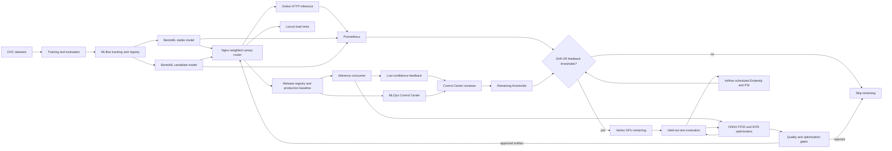

# Final architecture

The same model artifact supports online HTTP inference, batch inference, and
Redis Streams inference. Stable/candidate routing is operationally separate
from model training, which makes rollback a router change rather than a model
mutation. The Control Center is the operator-facing browser UI for release
history, gate evidence, deployment state, model identity, feedback readiness,
and the human reviewer queue. Durable lifecycle records are stored in
`reports/control-plane/releases.db`; the active serving baseline is stored in
`reports/retraining/deployed_baseline.json`.
